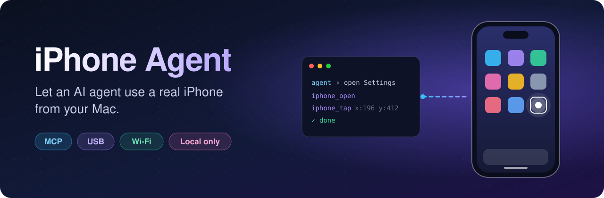
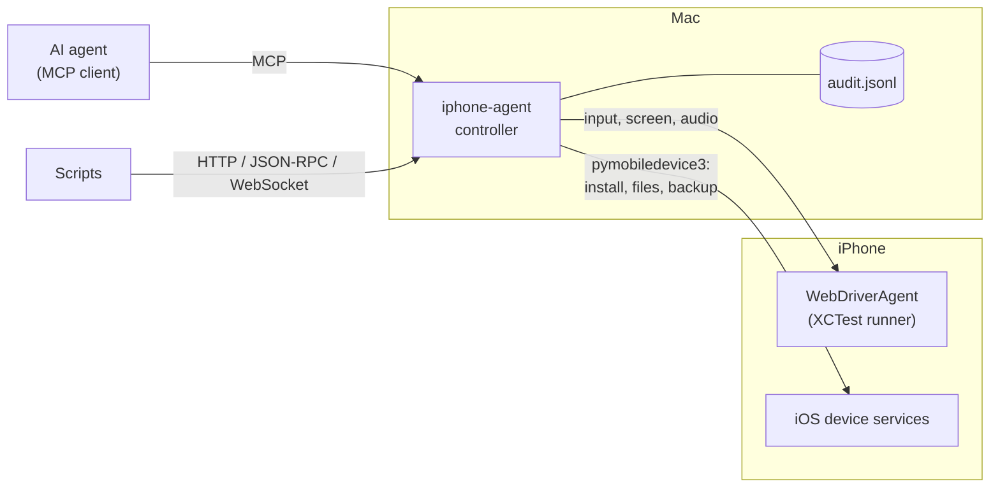

<p align="center">
  
</p>

<p align="center">
  <a href="https://github.com/edigeh/iphone-agent/actions/workflows/ci.yml"></a>
  <a href="https://github.com/edigeh/iphone-agent/releases/latest"></a>
  <a href="LICENSE"></a>
  
  
  
</p>

<p align="center">
  <a href="#-quick-start">Quick start</a> ·
  <a href="#-connect-your-agent">Connect your agent</a> ·
  <a href="#-what-it-can-do">Features</a> ·
  <a href="docs/reference.md">Reference</a> ·
  <a href="docs/hardware-support.md">Hardware support</a> ·
  <a href="CONTRIBUTING.md">Contributing</a>
</p>

---

**iPhone Agent** lets an AI agent see and use a physical iPhone the way you
would: it reads the screen, taps, swipes, types and opens apps. It runs entirely
on your Mac and talks to the phone over USB or Apple's paired Wi-Fi connection.

Agents connect through [MCP](https://modelcontextprotocol.io), so Claude Code,
Codex and any other MCP client can use it right away. Scripts get an
authenticated HTTP, JSON-RPC and WebSocket API.

> [!NOTE]
> **Alpha.** Interfaces may change between releases. See
> [hardware support](docs/hardware-support.md) for what has been tested on real
> phones.

## ✨ Why iPhone Agent

|  |  |
|---|---|
| 📱 **A real phone, not a simulator** | Work with real apps, real sign-ins and TestFlight or App Store builds on the device your users have. |
| 🔒 **Local and private** | No cloud account, no relay server. The API listens on `127.0.0.1` behind a bearer token. |
| 🔌 **USB or Wi-Fi** | Plug in a cable, or use Apple's paired network. `--network-fallback` switches between them by itself. |
| 🧾 **Every action on record** | A hash-chained audit journal writes each request before it runs and each result after. Typed text and clipboard contents are stored only as digests. |
| 🛡️ **Safe by default** | One controller per phone. A failed action is never replayed. Erase is off unless you turn it on. Keep-awake changes no setting on the phone. |
| 🧩 **Open source** | GPL-3.0-or-later, built on [WebDriverAgent](https://github.com/droidrun/WebDriverAgent) and [pymobiledevice3](https://github.com/doronz88/pymobiledevice3). |

## 🚀 Quick start

**You need:** a Mac with Xcode and your Apple developer account signed in to it,
Python 3.13+ with [uv](https://docs.astral.sh/uv/), and an iPhone that trusts
the Mac with Developer Mode on.

```sh
# 1. Get the controller and the WebDriverAgent source
git clone https://github.com/edigeh/iphone-agent.git
git clone https://github.com/droidrun/WebDriverAgent.git
git -C WebDriverAgent checkout 8ce9d6f

# 2. Install and check the phone connection
cd iphone-agent
uv sync
uv run iphone-agent doctor

# 3. Build, sign and install the on-phone runner (once)
uv run iphone-agent setup --source ../WebDriverAgent --team YOUR_TEAM_ID

# 4. Start it and send a tap
uv run iphone-agent serve
uv run iphone-agent call tap '{"x":100,"y":200}'
```

`setup` builds from a private copy of the WebDriverAgent source, so your
checkout stays unchanged. Your team ID is in Xcode → Settings → Accounts.

## 🤖 Connect your agent

**Claude Code**

```sh
claude mcp add iphone -- /absolute/path/to/iphone-agent/.venv/bin/iphone-agent mcp
```

**Any MCP client**

```json
{
  "mcpServers": {
    "iphone": {
      "command": "/absolute/path/to/iphone-agent/.venv/bin/iphone-agent",
      "args": ["mcp"]
    }
  }
}
```

Then ask your agent something like *"Open Settings on my iPhone and turn on Dark
Mode."* The server starts without a phone attached and connects on the first
tool call. That first call can take up to two minutes, so set your client's tool
timeout above that.

| Tool | What it does |
|---|---|
| `iphone_capabilities` | Connects, then reports the link, lock state, keep-awake and every available action |
| `iphone_state` | Accessibility tree of the foreground app, with element bounds in screen points |
| `iphone_screenshot` | PNG where one pixel is one screen point; `scale: 2` for more detail |
| `iphone_tap` | Tap at `x`, `y`; long press with `hold_ms` |
| `iphone_swipe` | Drag from `x1`, `y1` to `x2`, `y2` |
| `iphone_type` | Type into the focused field, optionally clearing it first |
| `iphone_press` | `home`, `back`, `app_switch`, `lock`, `unlock`, `volumeup`, `volumedown` |
| `iphone_open` | Launch an app by bundle ID, or open a URL or deep link |
| `iphone_action` | Any other action from the [reference](docs/reference.md#api-and-actions) |
| `iphone_disconnect` | Frees the phone when the task is done |

> [!IMPORTANT]
> The phone must be unlocked. The controller cannot enter Face ID or a passcode,
> so input sent to a locked phone returns a `PhoneLocked` error asking you to
> unlock it.

## 🧰 What it can do

<table>
<tr>
<td width="50%" valign="top">

**Control**
- Tap, long press, swipe, multi-finger gestures
- Type, clear text, keys, Home, lock, App Switcher
- Accessibility tree and screenshots
- Launch and stop apps, open deep links

**Apps and files**
- Install IPAs from disk or URL, list and uninstall apps
- Read and write files in the media folder or an app's container
- Clipboard, simulated location, time zone

</td>
<td width="50%" valign="top">

**Media**
- H.264/H.265 video and ReplayKit app audio streams
- Local WebRTC with touch and keyboard over the data channel
- MP4 recording

**More**
- SOCKS proxy through an optional VPN runner
- Read-only Messages snapshots from a local backup
- Experimental native adapter for iOS 27+
- Authenticated HTTP, JSON-RPC and WebSocket API

</td>
</tr>
</table>

## 📡 Without a cable

If Xcode can see your phone over Wi-Fi, use its hardware UDID
(with the cable plugged in, `uv run iphone-agent devices` shows it):

```sh
uv run iphone-agent setup --source ../WebDriverAgent --paired-network --udid YOUR_UDID --team YOUR_TEAM_ID --headless-assets
uv run iphone-agent serve --network-fallback --udid YOUR_UDID
```

`--network-fallback` uses USB while the cable is plugged in and Wi-Fi when it
isn't. Add the same flags after `mcp` in your client config.

## 🏗️ How it works



The controller launches the signed runner through Xcode's test plan and holds a
lock on the phone so that two controllers never fight over it. While an agent is
active it sends an F13 key event every 10 seconds, which keeps the screen on and
does nothing else. When the session ends, the phone locks on its normal
schedule.

## ❓ FAQ

<details>
<summary><b>Does it work with the iOS Simulator?</b></summary>

No. It drives physical iPhones over USB and Apple's paired network.
</details>

<details>
<summary><b>Do I need a paid Apple developer account?</b></summary>

The optional VPN proxy runner needs a paid team for its Network Extension
entitlement. For the standard runner, sign in to Xcode with your Apple account
and pass its team ID to `setup`.
</details>

<details>
<summary><b>Can two agents share one phone?</b></summary>

One controller holds a phone at a time. A second one gets a `PhoneBusy` error
that says who holds it and how to free it. An MCP session frees the phone when
the agent calls `iphone_disconnect`, when the client closes, or after 30 idle
minutes.
</details>

<details>
<summary><b>What gets logged?</b></summary>

Every request and result goes to a hash-chained journal in `~/.iphone-agent/`,
with digests in place of typed text, clipboard contents and credentials. Check
it with `uv run iphone-agent audit`.
</details>

<details>
<summary><b>Can it erase my phone?</b></summary>

Only if you start `serve` with `--allow-erase` and the request repeats the
phone's exact UDID. It is off by default.
</details>

## 🤝 Contributing

Bug reports, docs fixes and code are welcome. **Hardware reports are especially
valuable:** if you try a feature on your own iPhone, tell us the model, iOS
version and what happened in a
[hardware report](https://github.com/edigeh/iphone-agent/issues/new?template=hardware-report.yml).

```sh
uv sync
uv run ruff check .
uv run pytest -q   # runs against fakes, no phone needed
```

Read [CONTRIBUTING.md](CONTRIBUTING.md) before opening a pull request. Report
security issues privately as described in [SECURITY.md](SECURITY.md).

## 📄 License

[GPL-3.0-or-later](LICENSE). WebDriverAgent is a separate BSD-3-Clause project
that `setup` builds from source on your Mac. Dependency versions and licenses
are in [THIRD_PARTY.md](THIRD_PARTY.md).

<sub>iPhone is a trademark of Apple Inc. This project is not affiliated with or
endorsed by Apple.</sub>
